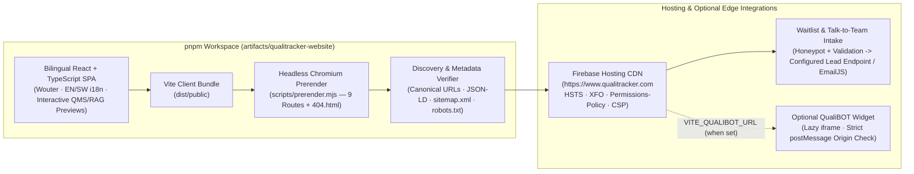

# QualiTracker Website (`qualitracker.com`)

**Bilingual (`EN` / `SW`) prerendered product website for QualiTracker — quality management and source-grounded laboratory intelligence for East African clinical and diagnostic laboratories.**

[](https://github.com/Qualitracker/qualitrackerwebsite/actions/workflows/ci.yml)

Live site: **[https://www.qualitracker.com](https://www.qualitracker.com)** · License: **[Proprietary (`UNLICENSED`)](LICENSE)**

---

## Implementation & Claim Posture

Public product copy and interactive illustrations are governed by [`docs/website/21_BETA_EVIDENCE_RECONCILIATION.md`](docs/website/21_BETA_EVIDENCE_RECONCILIATION.md):
- **Implemented & Live (`artifacts/qualitracker-website/`):** Bilingual English/Kiswahili (`src/lib/i18n.tsx`) React + Vite + Tailwind web experience with build-time Puppeteer static HTML prerendering across all 9 public routes plus `/404.html`, interactive clinical QMS & citation-grounded RAG product previews, waitlist/team contact intake, and Firebase Hosting delivery.
- **Commercial Honesty Boundary:** QualiTracker is in controlled laboratory beta validation. Interactive components on `/`, `/product`, and `/solutions` use explicitly labeled illustrative sample data—never fabricated customer metrics, unapproved laboratory names, or accreditation guarantees.

---

## Architecture Overview



### Key Engineering Decisions
1. **Real-Browser Static Prerendering (`scripts/prerender.mjs`):**
   - Instead of migrating a 9-route marketing site to a heavy SSR server runtime, `pnpm --filter @workspace/qualitracker-website build` boots `vite preview` locally and drives headless Chromium (`puppeteer`) across `/product`, `/solutions`, `/docs`, `/company`, `/security`, `/waitlist`, `/talk-to-team`, `/privacy`, `/`, and `/404.html` (`/` is intentionally rendered last so its homepage JSON-LD never leaks into subsequent routes via the SPA fallback shell).
   - Non-blocking Google Fonts `<link rel="preload" as="style">` attributes are restored prior to HTML serialization to eliminate ~800ms of render-blocking CSS on first paint, and `sitemap.xml` / `robots.txt` canonical parity is asserted before the build succeeds.
2. **Bilingual English & Kiswahili Parity (`src/lib/i18n.tsx`):**
   - Full UI, product workflow illustrations, and out-of-scope citation abstention demos support runtime switching between English (`EN`) and Kiswahili (`SW`), verified by dedicated automated tests (`src/test/i18n.test.tsx`).
3. **Origin-Checked Embed & Security Headers (`firebase.json`, `chat-widget.tsx`):**
   - Static responses enforce `Strict-Transport-Security`, `X-Content-Type-Options: nosniff`, `X-Frame-Options: DENY`, `Cross-Origin-Opener-Policy: same-origin`, and `Permissions-Policy`. The optional QualiBOT assistant iframe mounts lazily only when `VITE_QUALIBOT_URL` is provided and verifies `event.origin` before acting on close messages.

---

## Prerequisites & Local Development

### Prerequisites
- **Node.js 22.18+**
- **pnpm 11+** (`package.json` enforces `pnpm` via `preinstall`)

### Install & Run

```bash
pnpm install --frozen-lockfile

# Start local development server
pnpm --filter @workspace/qualitracker-website dev
```

---

## Verification & Automated Test Suites

Every pull request and push to `main` executes [`.github/workflows/ci.yml`](.github/workflows/ci.yml):

```bash
# 1. Workspace TypeScript typecheck
pnpm run typecheck

# 2. Vitest component, accessibility, SEO, i18n & form suite (11 files, 57 tests)
pnpm --filter @workspace/qualitracker-website test

# 3. Node native test runner — waitlist payload, honeypot & email delivery guards (3 tests)
pnpm --filter @workspace/qualitracker-website test:node

# 4. Production Vite bundle + headless Chromium static prerender & sitemap verification
pnpm --filter @workspace/qualitracker-website exec puppeteer browsers install chrome
BASE_PATH=/ pnpm --filter @workspace/qualitracker-website build
```

---

## Deployment & Environment Configuration

- **Firebase Hosting (`main`):** Merges to `main` trigger [`.github/workflows/firebase-hosting.yml`](.github/workflows/firebase-hosting.yml), which builds and prerenders `artifacts/qualitracker-website/dist/public` and deploys to Firebase Hosting when `FIREBASE_SERVICE_ACCOUNT` is configured.
- **Frontend Environment Variables (Build-Time Optional):**
  - `VITE_QUALIBOT_URL` — Optional HTTPS origin/URL for the embedded QualiBOT assistant widget.
  - `VITE_EMAILJS_SERVICE_ID` / `VITE_EMAILJS_PUBLIC_KEY` / `VITE_EMAILJS_TEMPLATE_WAITLIST` / `VITE_EMAILJS_TEMPLATE_CONTACT` — Optional client form transport keys (see [`docs/WAITLIST_EMAIL_SETUP.md`](docs/WAITLIST_EMAIL_SETUP.md)).

---

## Repository Layout

```text
.
├── artifacts/qualitracker-website/  # React + TypeScript + Tailwind site, Vitest suites & Puppeteer prerenderer
├── docs/
│   ├── website/                     # Brand, UX, accessibility, SEO, performance & beta-evidence reconciliation docs
│   └── WAITLIST_EMAIL_SETUP.md      # Form delivery configuration guide
├── firebase.json                    # Firebase Hosting headers, caching & 301 redirects
├── SECURITY.md                      # Vulnerability reporting & public-repo hygiene rules
└── .github/workflows/               # CI verification & Firebase Hosting deployment pipelines
```

---

## Security & License

- **Security Policy:** [`SECURITY.md`](SECURITY.md)
- **License:** Proprietary (`UNLICENSED`) — Copyright (c) 2026 QualiTracker. All Rights Reserved ([`LICENSE`](LICENSE)).
